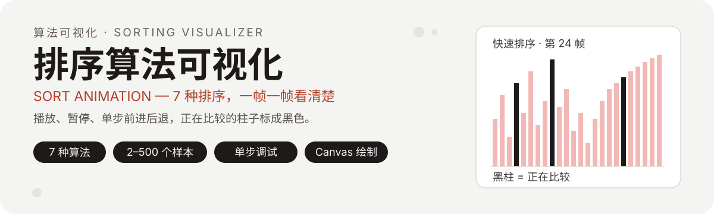
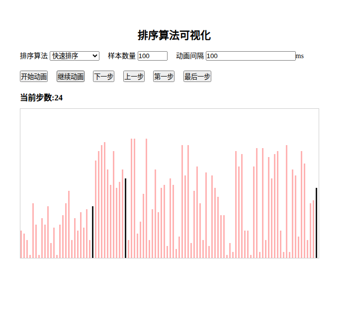

<p align="right"><a href="README.md">中文</a></p>

<p align="center">
  
</p>

<p align="center">
  <a href="https://xiaosang.cc/sort-animation/">▶ Try Online</a>
  ·
  <a href="https://github.com/holynova/sort_animation">GitHub Repository</a>
</p>

Sort Animation visualizes 7 classic sorting algorithms frame by frame. Pick an algorithm, set the sample size and animation interval, and watch the bars swap on a Canvas — the bars being compared turn black. Pause anytime, step forward or backward one frame, or jump to the first or last frame.

## Screenshots

<p align="center">
  
</p>

> The page layout is fixed at 620px wide; the screenshot was taken at the real layout, not stretched.

## Algorithms

| Algorithm | Default | Notes |
|------|------|------|
| 冒泡排序 (Bubble Sort) | | Compare and swap neighbors |
| 快速排序 (Quick Sort) | ✓ | Selected by default; partitions on the last element as pivot |
| 归并排序 (Merge Sort) | | Divide and conquer merge |
| 堆排序 (Heap Sort) | | Heap adjustment |
| 插入排序 (Insertion Sort) | | Insert one by one into the sorted region |
| 简单选择排序 (Selection Sort) | | Pick the minimum each round |
| 鸡尾酒排序 (Cocktail Sort) | | Bidirectional bubble sort |

All 7 algorithms are implemented in `src/scripts/index.js`; each records every frame — the array state plus the highlighted indices — into a history array, which the player replays frame by frame.

## Controls

- **排序算法 (Algorithm)**: dropdown to pick one of the 7 algorithms (switching regenerates the frame sequence).
- **样本数量 (Sample Size)**: 2–500, default 100 (a random integer array of 0–99).
- **动画间隔 (Animation Interval)**: in milliseconds, default 100ms; controls playback speed.
- **开始动画 / 暂停动画 (Start / Pause)**: play and pause (the button becomes 「继续动画」 "Resume" after pausing).
- **下一步 / 上一步 (Next / Previous Step)**: step forward or backward one frame.
- **第一步 / 最后一步 (First / Last Step)**: jump to the start or end of the frame sequence.
- **当前步数 (Current Step)**: the current frame number, shown live above the canvas (e.g. 「当前步数: 24」).

## Run Locally

A webpack 3 + Babel 6 project (2017-era stack) — the build may fail on modern Node; use the published build, or try:

```bash
npm install
npm run build    # webpack bundle, output in dist/
npm start        # webpack-dev-server
```

> Note: the repository name, description, and author fields in `package.json` are empty, and `sort.js` is an old module with only bubble / quick / merge (used by `test.js` for correctness comparison); the UI actually uses the 7 implementations in `index.js`.

## Tech

- Canvas rendering: each frame draws bars from the array — ordinary bars in light red `rgba(255,0,0,0.3)`, bars being compared in near-black `rgba(0,0,0,0.9)`; canvas is 600×300 inside a fixed 620px-wide page container.
- Frame-replay model: algorithms don't draw directly; instead, each step's array snapshot + highlighted indices are stored in a history array, and the player redraws frame by frame on a timer — which is why playback can pause, step, and jump.
- Correctness tests: `src/scripts/test.js` checks bubble / quick / merge against native `Array.sort` (100 random cases, 9999 elements each, 1s limit).

```
src/index.html          Entry: 620px container, settings area, 6 control buttons, 600×300 Canvas
src/scripts/index.js    All logic: 7 sorts + frame recording + Canvas drawing + player
src/scripts/sort.js     Old module: bubble / quick / merge (for test comparison)
src/scripts/test.js     Correctness tests: against native sort
src/scripts/utils.js    Random array generation, testSort utility
src/styles/style.scss   Styles: 620px container, button spacing
webpack.*.js            webpack 3 build config
```
