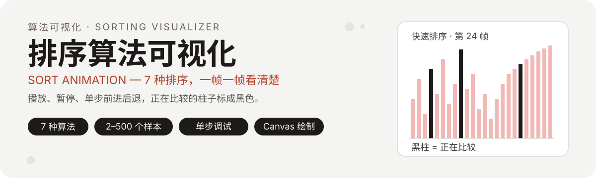

<p align="center">
  
</p>

<p align="center">
  <a href="https://xiaosang.cc/sort-animation/">▶ 在线体验 Online Demo</a>
  ·
  <a href="https://github.com/holynova/sort_animation">GitHub 仓库</a>
</p>

排序算法可视化：7 种经典排序算法，一帧一帧看清楚。选算法、设样本数量与动画间隔，点开始就在 Canvas 上看柱子交换位置；正在比较的柱子标成黑色，随时暂停、单步前进 / 后退、跳到第一帧或最后一帧。

Sort Animation visualizes 7 classic sorting algorithms frame by frame. Pick an algorithm, set the sample size and animation interval, and watch the bars swap on a Canvas — the bars being compared turn black. Pause anytime, step forward or backward one frame, or jump to the first or last frame.

## 截图 / Screenshots

<p align="center">
  
</p>

> 页面布局写死 620px 宽，截图按实际布局拍摄，未拉宽。

## 算法 / Algorithms

| 算法 | 默认 | 说明 |
|------|------|------|
| 冒泡排序 | | 相邻比较交换 |
| 快速排序 | ✓ | 默认选中；以末尾元素为基准（pivot）分区 |
| 归并排序 | | 分治归并 |
| 堆排序 | | 堆调整 |
| 插入排序 | | 逐个插入有序区 |
| 简单选择排序 | | 每轮选最小 |
| 鸡尾酒排序 | | 双向冒泡 |

7 种算法均在 `src/scripts/index.js` 中实现，每种在排序过程中把每一帧的数组状态与高亮下标记进历史记录，播放器按帧回放。

## 操作 / Controls

- **排序算法**：下拉选择 7 种算法之一（切换后重新生成帧序列）。
- **样本数量**：2–500，默认 100（随机生成 0–99 的整数数组）。
- **动画间隔**：毫秒，默认 100ms，可调播放速度。
- **开始动画 / 暂停动画**：播放与暂停（暂停后按钮变为「继续动画」）。
- **下一步 / 上一步**：单步前进或后退一帧。
- **第一步 / 最后一步**：跳到帧序列的开头或结尾。
- **当前步数**：画布上方实时显示当前帧号（如「当前步数: 24」）。

## 本地运行 / Run Locally

webpack 3 + Babel 6 的老项目（2017 年技术栈），现代 Node 下构建可能失败；推荐直接用线上构建产物，或按以下方式尝试：

```bash
npm install
npm run build    # webpack 打包，产物在 dist/
npm start        # webpack-dev-server 开发服务器
```

> 注意：`package.json` 里仓库名、描述、作者均为空，`sort.js` 是只含冒泡 / 快速 / 归并三算法的旧模块（供 `test.js` 做正确性对照测试用），界面实际用的是 `index.js` 里的 7 种实现。

## 技术 / Tech

- Canvas 绘制：每帧按数组画柱状条，普通柱 `rgba(255,0,0,0.3)` 淡红，正在比较的柱 `rgba(0,0,0,0.9)` 近黑；画布 600×300，页面容器写死 620px 宽。
- 帧回放模型：算法执行时不直接画图，而是把每一步的数组快照 + 高亮下标存进历史数组，播放器用定时器按间隔逐帧重绘——因此可以暂停、单步、跳帧。
- 正确性测试：`src/scripts/test.js` 把冒泡 / 快速 / 归并三算法与原生 `Array.sort` 对照（100 组随机用例，每组 9999 个元素，1 秒时限）。

```
src/index.html          入口：620px 容器、设置区、6 个控制按钮、600×300 Canvas
src/scripts/index.js    全部逻辑：7 种排序 + 帧记录 + Canvas 绘制 + 播放器
src/scripts/sort.js     旧模块：冒泡 / 快速 / 归并三算法（供测试对照）
src/scripts/test.js     正确性测试：与原生 sort 对照
src/scripts/utils.js    随机数组生成、testSort 测试工具
src/styles/style.scss   样式：620px 容器、按钮间距
webpack.*.js            webpack 3 构建配置
```

## English

**Sort Animation** visualizes 7 classic sorting algorithms frame by frame on a Canvas.

- **Algorithms**: bubble, quick (default, last-element pivot), merge, heap, insertion, selection, and cocktail sort — all implemented in `src/scripts/index.js`, each recording every frame (array snapshot + highlighted indices) into a history array.
- **Controls**: algorithm dropdown, sample size (2–500, default 100 random integers 0–99), animation interval in ms (default 100), play / pause, step forward / backward one frame, jump to first / last frame. The current frame number shows above the canvas.
- **Rendering**: bars are light red (`rgba(255,0,0,0.3)`); bars being compared turn near-black. Canvas is 600×300 inside a fixed 620px-wide page.
- **Run it**: a webpack 3 + Babel 6 project (2017-era stack) — `npm install`, `npm run build` (output in `dist/`), `npm start` for the dev server. The build may fail on modern Node.
- **Tests**: `src/scripts/test.js` checks bubble / quick / merge against native `Array.sort` (100 random cases, 9999 elements each, 1s limit).

## 许可 / License

ISC（见 `package.json`；仓库内暂无 LICENSE 文件）。
