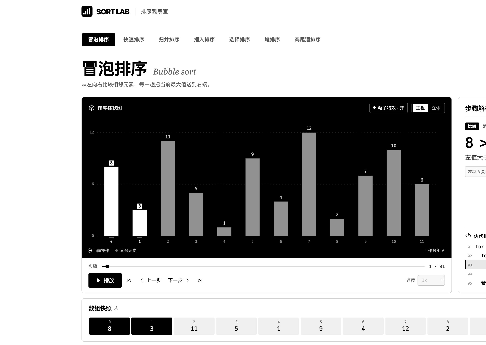

# 排序观察室 · Sort Lab

[在线体验](https://sort-animation.xiaosang.cc/) · [GitHub](https://github.com/holynova/sort_animation)

[English](README.en.md)

在同一组数字上逐步观察冒泡、快速、归并、插入、选择、堆和鸡尾酒排序。打开时停在冒泡排序的第一次比较。下标 0 和 1 的值分别是 8 和 3，点击「下一步」即可观察它们交换位置。



## 如何观察

- 柱高表示数值。正视图中每个元素是一根实心直柱，白色标出当前操作。切换到立体视图可拖动调整角度，点选柱子或数组格可查看下标和值。
- 粒子只在排序动作发生时出现。比较激起两端的火花，交换的直柱带出反向彗尾与落点冲击环，归并写回产生从缓冲下标落下的粒子束。完成时，粒子沿有序柱顶依次绽开。所有动作结束后，图表静止。
- 每一步显示比较结果、交换或写入的原因，以及当时执行的伪代码。快排标出基准 P，归并比较时标明缓冲 B 的区间，底部快照始终展示主数组 A。一次交换计为两次写入。
- 左右方向键逐步前进和回退，空格播放或暂停，Home / End 跳到起点或终点。时间轴可定位任意步骤。图表右上角的「粒子特效」可单独切换动效。开启系统减弱动态时，默认直接显示每步结果。
- 支持 2–500 个元素。切换算法时复用同一组初始数据，便于对照比较次数和写入次数。
- 页首可开启同步音效。数值决定音高，比较依次敲响两个音，交换产生交叉滑音，归并写回产生落键音。

## 本地运行

使用 Node.js 20 或更新版本。

```sh
npm ci
npm test
npm run build
```

双击 `dist/index.html` 即可离线使用。开发时运行 `npm start`，打开终端打印的地址。Canvas 先绘制事件粒子，再绘制实心柱与数值，每 256 次操作保存一次数组检查点以支持回放。


推送主分支（`git push origin master`）后，Cloudflare Pages 运行 `npm run build`，发布 `dist/`。

<a href="https://sort-animation.xiaosang.cc/"></a>
